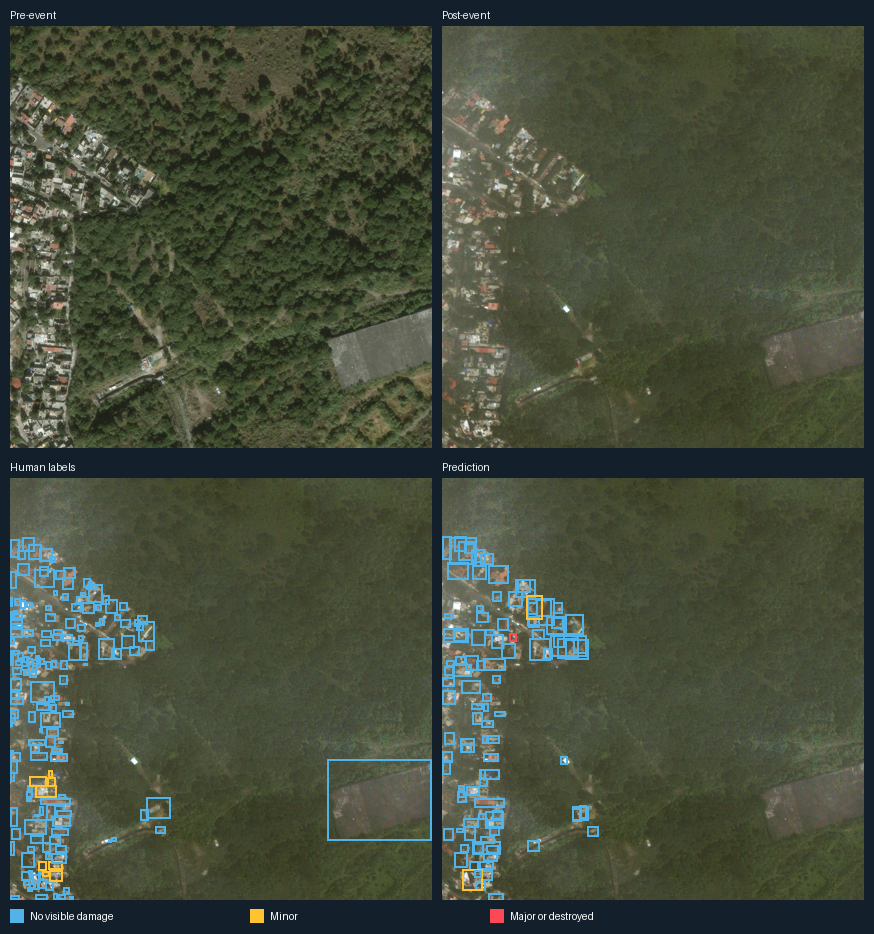
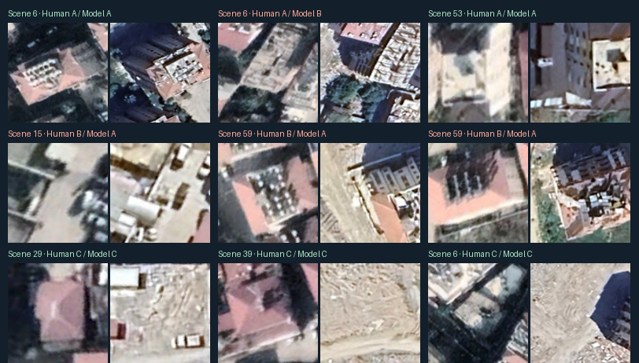
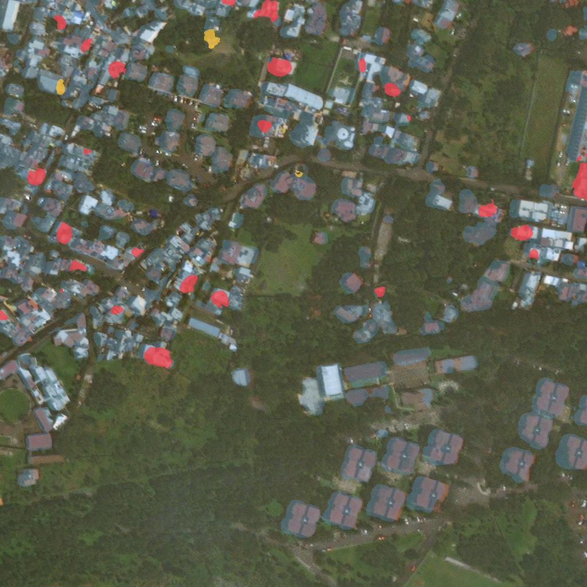
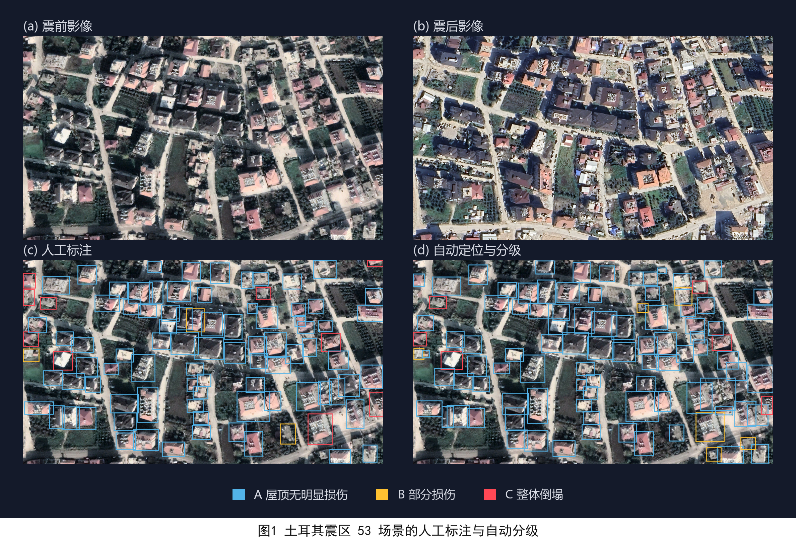

# 震后建筑定位与损伤分级

基于**同尺寸、已配准的震前 / 震后 RGB 卫星影像**，同时完成建筑物定位与损伤等级分类（未受损 / 轻损 / 重损或毁坏）。仓库包含两代实现：

1. **第一代：像素级双时相 Transformer**（约 19.7 万参数，单卡可训）——共享双时相编码器 + 两个四头自注意力块 + 多尺度时相差分融合 + 建筑定位 / 损伤分类双输出头；
2. **第二代重训流水线（2026-11）**：Swin FPN 建筑检测器 + DINOv2 / 纹理双分级器，并在阿富汗、摩洛哥等辅助数据上做迁移与难负样本实验；
3. **第三代候选框 Transformer（2026-11-27）**：Swin 候选框 + 冻结 DINOv2 特征 + RoI 跨时相注意力分级头，并与旧模型按类别融合；包含 ViT-B/ViT-L 骨干对照与 0.20/0.24 低定位阈值实验。见文末「2026-11-27 更新」。

核心结论：**建筑定位已达到可用水平；损伤分级（尤其轻损）仍远未达到 80% 的目标**，瓶颈主要在轻损样本稀少、时相配准和标注质量。三代模型在墨西哥开发验证集上的三档宏 F1 分别为 0.2296（旧模型）、0.2309（旧模型 + ViT-B 注意力头融合）、0.2332（旧模型 + ViT-L 池化头融合），最后一次提升在样本量下不显著；土耳其测试集端到端正确率为 69.06%。详见 [`retrain/README.md`](retrain/README.md) 与 [`retrain/震后建筑损伤训练方案.md`](retrain/震后建筑损伤训练方案.md)。

## 结果速览

### 墨西哥留出集（同一批 34 对影像）

建筑框按 IoU ≥ 0.50 与人工框匹配，且同一建筑只匹配一次。

| 模型 | 建筑框 F1 | 端到端三档宏 F1 | 人工标注建筑中正确定位且分级 | 判对轻损 | 判对重损 |
|---|---:|---:|---:|---:|---:|
| 旧模型（第一代像素模型） | 21.43% | 7.13% | 25.95% | 0/27 | 0/5 |
| 首轮重训 | 34.86% | 11.62% | 41.12% | 1/27 | 0/5 |
| Swin 定位 + 双分级器（本轮） | 47.31% | 15.61% | 47.13% | 0/27 | 0/5 |

- 给定人工建筑框时，本轮正确分级 1 栋轻损、0 栋重损，三档宏 F1 为 0.3382，Cohen's κ 为 0.0184；
- 整图像素吻合率 82.11%（κ 0.5969），但主要来自背景与未受损区域，轻损 / 重损像素宏 F1 仅 0.0023；
- 对照图：

### 土耳其 OCD-BDA 留出集（1,432 栋人工框建筑）

| 设置 | 主要指标 |
|---|---|
| 给定人工建筑框分级 | 总体正确率 81.15%，三档宏 F1 0.7255，κ 0.6907（A 0.8487 / B 0.4359 / C 0.8919） |
| 自动定位（Swin 检测） | 建筑框 F1 0.7828，正确定位且分级 989/1,432（69.06%），三档宏 F1 0.5836（部分损伤 67/184，倒塌 491/671） |

样例对照：

### 第一代像素级模型（首轮 38 对测试影像）

| F1 指标 | 逐像素模型 | 按建筑分级复测 |
|---|---:|---:|
| 建筑定位 | 0.7832 | 0.7832 |
| 未受损 | 0.7534 | 0.7341 |
| 轻损 | 0.0000 | 0.0007 |
| 重损或毁坏 | 0.0082 | 0.0233 |
| 任意损伤 | 0.0231 | 0.0345 |

建筑定位 IoU 0.6437。基于人工轮廓的建筑级诊断中，84 栋轻损建筑均未判对等级，32 栋重损 / 毁坏建筑两版分别正确分级 2 栋和 1 栋。预测示例：



## 目录结构

```
.
├─ README.md                     # 本文件
├─ requirements.txt              # 运行依赖
├─ model.py                      # 第一代：双时相 Transformer 模型
├─ prepare.py                    # 数据切片 / 缓存（建筑提取与地震损伤）
├─ train.py                      # 第一代：训练入口
├─ train_regions.py              # 按建筑分级模型训练
├─ region_model.py               # 按建筑分级模型
├─ evaluate.py / evaluation.py   # 测试、逐类指标与建筑级诊断
├─ fit_damage.py / select_checkpoint.py
├─ infer.py                      # 推理入口（逐像素 / 按建筑分级）
├─ docs/
│  └─ pixel-model.md             # 第一代模型原始说明文档
├─ run/                          # 第一代权重、指标与示例输出
│  ├─ damage_model.pt            # 逐像素模型权重（约 0.8 MB）
│  ├─ building_best.pt / damage_best.pt
│  ├─ region_final/              # 按建筑分级最终权重与测试结果
│  ├─ regions/ regions_refined/  # 区域模型训练记录
│  └─ ...                        # 各轮验证记录、测试指标、对照图
├─ retrain/                      # 第二代重训流水线（2026-11）
│  ├─ README.md                  # 详细实验记录（数据划分、消融、结果）
│  ├─ *.py                       # 检测 / 分级 / 数据审计 / 推理脚本
│  ├─ data/                      # 仅保留数据清单与审计 JSON（原始影像不发布）
│  └─ run/                       # 各实验的验证 / 测试记录与对照图
```

## 快速开始

### 环境

原实验环境为 Python 3.8 + PyTorch 1.12.1 + CUDA 11.3（单卡即可）；依赖见 `requirements.txt`：

```bash
pip install -r requirements.txt
```

部分数据准备脚本使用 GDAL（`osgeo`），需另行安装，例如 `conda install -c conda-forge gdal`。

### 用已训练权重推理（第一代逐像素模型）

输入为同尺寸、已配准的震前 / 震后影像，输出保持原影像像素尺寸：

```bash
python infer.py --pre pre_disaster.png --post post_disaster.png --out run/prediction_local
```

输出文件：

| 文件 | 内容 |
|---|---|
| `damage_mask.png` | 像素编码 0 背景、1 未受损、2 轻损、3 重损或毁坏 |
| `footprint.png` | 二值建筑范围 |
| `damage_colors.png` | 蓝色未受损、黄色轻损、红色重损或毁坏 |
| `damage_overlay.png` | 叠加在震后影像上的分级预测 |
| `prediction.json` | 影像尺寸、各级像素数、使用的权重 |

### 按建筑分级推理（第一代区域模型）

```bash
python infer.py --pre pre_disaster.png --post post_disaster.png \
  --region-checkpoint run/region_final/region_model.pt --out run/region_prediction
```

### 复现训练（第一代，详见 `docs/pixel-model.md`）

```bash
python prepare.py building --building-limit 4096
python prepare.py earthquake
python train.py building --epochs 10 --batch 16 --seconds 1600
python train.py earthquake --epochs 72 --batch 8 --steps 132 --seconds 5200
python select_checkpoint.py run/damage_best.pt
python evaluate.py
```

### 第二代重训流水线

见 [`retrain/README.md`](retrain/README.md)，包含 Swin 建筑检测、DINOv2 特征分级、难负样本、跨地震迁移、太阳几何特征等实验，以及墨西哥 / 土耳其复测方法。

## 数据

**原始影像、切片缓存与训练特征不随仓库发布**，需自行获取并按各数据的许可使用（仅限研究用途）：

| 数据 | 用途 | 来源 |
|---|---|---|
| xBD / xView2（2019，CVPRW） | 墨西哥地震双时相影像与建筑损伤标注（墨西哥城） | <https://openaccess.thecvf.com/content_CVPRW_2019/papers/cv4gc/Gupta_Creating_xBD_A_Dataset_for_Assessing_Building_Damage_from_Satellite_CVPRW_2019_paper.pdf> |
| OCD-BDA（2024，Remote Sensing；人工复核版） | 土耳其震后建筑损伤（A/B/C 三档） | <https://www.mdpi.com/2072-4292/16/22/4263> / <https://doi.org/10.5281/zenodo.21296833> |
| MEDBFS（2024，Data）与赫拉特开放数据 | 阿富汗赫拉特辅助正样本 | <https://www.mdpi.com/2306-5729/9/7/88> / <https://zenodo.org/records/11241134> |
| Copernicus EMS（EMSR244 / EMSR695） | 震害分级范围、摩洛哥辅助样本 | <https://mapping.emergency.copernicus.eu/activations/EMSR244/> / <https://mapping.emergency.copernicus.eu/activations/EMSR695/> |
| Maxar Open Data | 摩洛哥震前 / 震后光学图块 | <https://xpress-docs.maxar.com/OpenData/OpenData_events.htm> |
| Open Buildings（HDX） | 摩洛哥震前屋顶轮廓 | <https://data.humdata.org/dataset/openbuildings_morocco_earthquake_footprint> |
| 墨西哥城普查 / UNAM / UNOSAT 图层 | 外部标签交叉核对 | 见 `retrain/README.md` |

数据划分与审计记录保留在仓库中：`retrain/data/manifest.json`、`retrain/data/audit.json`、`retrain/data/development_image_audit.json`、`retrain/data/turkey/split.json`、`retrain/data/external/**`、`retrain/data/features/*.json`。

### 需要按本机环境修改的路径

第一代数据准备脚本中以下常量指向原始数据位置，运行前需改为本机路径：

| 文件 | 常量 |
|---|---|
| `prepare.py` | `BUILDING_ROOT = Path("F:/transformer/building train")` |
| `prepare.py` | `EARTHQUAKE_ROOT = Path("D:/pc/earthquake data")` |
| `retrain/extract_xbd.py` | `ARCHIVES = Path("D:/pc/earthquake data/xView2/data")` |
| `retrain/inventory.py` | `INPUT = Path("D:/pc/earthquake data")` |

第二代流水线约定：预训练权重放在 `retrain/weights/`（DINOv2、Swin、SatlasPretrain，约 670 MB，**未包含在仓库中**），缓存放 `retrain/data/`，实验输出放 `retrain/run/`。

## 方法要点

- **第一代**：共享双时相编码器；每路 2 个四头自注意力 Transformer 块；多尺度融合时相差值；建筑定位头 + 损伤分类头。训练时对双时相影像做 256 像素切片与重叠拼接，按类平均的损失缓解损伤样本稀少，验证集用于选择权重和校准损伤阈值。
- **标注合并**：xBD 中毁坏样本极少，训练时把「重损」与「毁坏」合并为一档；`un-classified` 建筑只参与定位训练。
- **第二代**：Swin FPN 提供建筑框；分级器使用 DINOv2 冻结特征 + 纹理/配准特征，比较了轻量损伤头、关键点配准、RBF、完好外观预测、跨地震迁移、阿富汗辅助正样本、摩洛哥辅助样本、太阳方位/高度角阴影特征、SatlasPretrain 特征等方案；最终保留 Swin 定位 + 双分级器配置。
- **评测**：验证集决定权重与阈值，留出测试集只评一次；同时报告逐像素指标、建筑框匹配指标和「给定人工框」的诊断结果，用于区分定位瓶颈与分级瓶颈。

## 结果文件索引

| 路径 | 内容 |
|---|---|
| `run/test_metrics.json` | 第一代逐像素模型测试指标 |
| `run/test_by_tile.csv` | 第一代逐切片结果 |
| `run/selection.json` | 第一代阈值与权重选择记录 |
| `run/region_final/test_metrics.json` | 按建筑分级复测指标 |
| `retrain/run/mexico_followup_holdout/` | 墨西哥留出集复测完整记录（指标、对照图、逐切片结果） |
| `retrain/run/turkey_vit/test.json` | 土耳其给定人工框分级混淆矩阵 |
| `retrain/run/turkey_automatic/test.json` | 土耳其端到端（自动定位）记录 |
| `retrain/run/mexico_final/` | 墨西哥最终配置、阈值与候选审计 |
| `retrain/run/proposal_*/` | 第三代候选框 Transformer 的对照组、融合配置、定位 / 独立测试审计 |
| `retrain/run/ds_vitl_*/`、`ds_floor20_*/` | 第三代 ViT-L 骨干与 0.20 定位阈值对照实验 |
| `retrain/run/typical_figures/` | 土耳其测试集准确率最高的三个场景四联图与逐场景指标 |

## 已知限制

- 测试覆盖同一批墨西哥地震与土耳其地震影像，**未验证跨地震泛化**；
- 轻损样本仅 157 栋（训练）/ 27 栋（留出），损伤分级尤其是轻损仍未达到可用精度；
- 独立阴影掩膜、多光谱与 SAR 融合、结构完整度损失百分比估计超出当前输入与标注范围，未纳入；
- 部分实验（太阳几何、辅助数据迁移）提升很小，未改变最终配置。

## 说明

- `docs/` 与 `retrain/` 中的历史实验记录保留了作者本机路径（如 `D:\土坑论文\...`、`F:\transformer\...`），仅作为实验环境记录，复现时请替换为相对路径或本机路径。
- 仓库体积约 65 MB：包含第一代与第三代模型权重（分级头）、精选指标 / 对照图与典型结果图；数据集、缓存、Swin 检测器与 DINOv2 骨架等大权重未包含，避免仓库膨胀。
- 代码与实验结果由本项目作者整理，欢迎交流。

## 2026-11-27 更新：候选框 Transformer（第三代）

在「Swin 定位 + DINOv2 / 纹理双分级器」的基础上，新增一条**候选框（proposal）双时相分级流水线**，把定位与分级解耦，并落实文献中的跨时相注意力做法：

- 用 Swin FPN 在震前影像生成建筑候选框（默认阈值 0.36，可用 `--detector-floor` 调整）；
- 每个候选框裁 168×168 的震前 / 震后成对图块，冻结 DINOv2 ViT-B/14（或 ViT-L/14）编码特征；
- RoI 双时相 Transformer 分级头：局部跨时相注意力 + 前/后特征差值 + 两层空间 Transformer + 建筑内外加权池化，输出「有效建筑概率 + 未受损 / 轻损 / 重损」四路 logits；
- 训练混合人工框、人工框偏移增强和 Swin 实际候选框，与人工框 IoU < 0.20 的候选框降权为负样本；
- 推理时把新分级头与旧模型（`run/mexico_large_selection`）按轻损 / 重损分别做对数分数融合，融合权重与阈值只在验证集上选择。

### 墨西哥开发验证集结果（27 对影像，54,499 栋未受损 / 37 栋轻损 / 10 栋重损）

| 配置 | 三档宏 F1 | 损伤档宏 F1 | 定位 F1 | 轻损 / 重损匹配 |
|---|---:|---:|---:|---:|
| 旧模型基线（ViT-L + ViT-B 分级器） | 0.2296 | 0.0708 | 0.5524 | 27/37、5/10 |
| 旧模型 + ViT-B 注意力头融合 | 0.2309 | 0.0729 | 0.5524 | — |
| ViT-B 注意力头（混合候选框） | 0.2067 | 0.0366 | 0.5524 | 27/37、5/10 |
| ViT-B 池化头 | 0.2013 | 0.0333 | 0.5524 | 27/37、5/10 |
| ViT-B 仅人工框训练 | 0.2035 | 0.0312 | 0.5524 | 27/37、5/10 |
| ViT-B 注意力头 + 摩洛哥辅助 | 0.2054 | 0.0382 | 0.5473 | 27/37、5/10 |
| ViT-B 注意力头 + 0.24 定位阈值 | 0.2087 | 0.0504 | 0.5305 | 31/37、6/10 |
| ViT-L 注意力头 | 0.2014 | 0.0346 | 0.5530 | 27/37、5/10 |
| ViT-L 池化头 | 0.2085 | 0.0425 | 0.5524 | 27/37、5/10 |
| **旧模型 + ViT-L 池化头 50% 融合** | **0.2332** | **0.0758** | — | — |
| ViT-L 注意力头 + 旧模型融合 | 0.2296 | 0.0708 | — | 网格把新头权重压到 0 |
| ViT-B 注意力头 + 0.20 定位阈值 | 0.1955 | 0.0416 | 0.5080 | 32/37、6/10 |
| ViT-B 池化头 + 0.20 定位阈值 | 0.1768 | 0.0143 | 0.5080 | — |

- **骨干容量不是瓶颈**：ViT-L 与 ViT-B 在 0.20 个百分点内，没有稳定收益。
- **继续降低定位阈值没有帮助**：0.20 阈值把损伤建筑候选覆盖从 27→32、5→6 提上去，但未受损类误报增加更多，整体宏 F1 反而下降，0.24 已是最佳折中。
- 当前验证集最好结果（旧模型 + ViT-L 池化头 50% 融合，0.2332）相对基线只高 0.36 个百分点，而验证集仅 37 栋轻损、10 栋重损，单次波动即可覆盖该增益，**不能视为实质改进**。34 对历史留出影像的回归复测因并行 GPU 任务未完成（记录见训练方案文末）。
- 结论与下一步：瓶颈是损伤标注数量 / 质量与检测器精度；优先补标轻损 / 重损建筑并改进检测器，而不是继续加大骨干或降低阈值。

### 土耳其测试集典型结果（按逐场景正确率选前三）

口径与报告一致：自动定位（框 IoU ≥ 0.50 一对一匹配）且三档分级正确的建筑数 ÷ 人工标注建筑总数，测试集未参与训练或调参。

| 场景 | 正确 / 标注 | 正确率 |
|---|---:|---:|
| 53 | 82/95 | 86.32% |
| 59 | 106/129 | 82.17% |
| 04 | 127/158 | 80.38% |
| 全部 11 个测试场景 | 989/1,432 | 69.06% |

（墨西哥 34 对留出影像中单场景最高为 77.9%，低于土耳其前三，因此按「任何地区」排序时前三名都来自土耳其。）



其余两张：`retrain/run/typical_figures/scene59_typical_caption.png`、`retrain/run/typical_figures/scene04_typical_caption.png`；逐场景预测框见同目录 `scene*_predictions.csv`，排名见 `retrain/run/turkey_automatic/typical_ranking.json`。

### 新增代码与复现命令

| 文件 | 作用 |
|---|---|
| `retrain/train_proposal_transformer.py` | 候选框流水线入口（prepare / train / fuse / test / image / audit-location） |
| `retrain/roi_transformer.py` | RoI 双时相 Transformer 分级头 |
| `retrain/evaluate_test_folder.py` | 独立 / 已知测试文件夹的输入审计与评估 |
| `retrain/make_typical_figures.py`、`retrain/rank_turkey_scenes.py` | 典型结果四联图与逐场景正确率排名 |
| `retrain/震后建筑损伤训练方案.md` | 数据、文献依据、实验方案、本机验证记录与 2026-11-27 执行记录 |

```powershell
# 准备特征缓存（默认 ViT-B；ViT-L 用 --weights .\weights\dinov2_vitl14_pretrain.pth --encode-batch 8）
python retrain/train_proposal_transformer.py prepare
# 训练分级头（attention / pooled / manual-only / morocco）
python retrain/train_proposal_transformer.py train --variant attention --out retrain/run/ds_attention
# 与旧模型融合（参考配置见 retrain/run/proposal_fusion/fusion.json）
python retrain/train_proposal_transformer.py fuse --out retrain/run/ds_attention --result retrain/run/ds_fusion
# 历史留出回归复测
python retrain/train_proposal_transformer.py test --out retrain/run/ds_attention --fusion retrain/run/ds_fusion/fusion.json --regression --result retrain/run/ds_regression
```

### 本更新新增的目录

- `retrain/train_proposal_transformer.py`、`roi_transformer.py`、`evaluate_test_folder.py`、`evaluate_turkey_transfer.py`
- `retrain/make_typical_figures.py`、`rank_turkey_scenes.py`、`震后建筑损伤训练方案.md`
- `retrain/run/proposal_*`：ViT-B 候选框对照组、融合配置、定位审计、独立测试审计
- `retrain/run/ds_vitl_*`、`retrain/run/ds_floor20_*`：ViT-L 骨干与 0.20 定位阈值对照
- `retrain/run/typical_figures/`：三张典型结果图、逐场景预测框与指标
- `retrain/run/mexico_large_*`、`retrain/run/prediction_large/`、`retrain/run/turkey_mexico_transfer/` 等旧流水线补充记录（仅小体积 JSON / CSV / 对照图）

### 权重说明

- 分级头权重已包含：`retrain/run/*/head.pt`（0.7–1.5 MB/个），融合配置 `fusion.json` 与参考模型选择记录也已包含。
- 体积过大的文件未包含：Swin 检测器 `run/*/detector.pt`（约 114 MB）、DINOv2 骨架 `retrain/weights/*.pth`（84–1161 MB）、旧流水线编码器 `run/mexico_vitl112/mexico_vit.pt` 等；推理前需按 `retrain/README.md` 与训练方案自行准备。


## 2026-11-27 更新（二）：跨震区混合训练与独立验证

针对「墨西哥 27 个验证场景上调参不泛化」的问题，本轮把本地 xBD 中此前未使用的**帕卢 2018 地震 + 海啸**数据加入训练，并用土耳其 2023 的 KATE-CD 做独立验证。

### 数据

- 帕卢训练：113 对影像（25,455 栋未受损 / 571 重损 / 4,966 毁坏 / 1 轻损 / 401 未分级）；帕卢官方测试：42 对（10,927 / 250 / 1,237，无轻损），作为跨地震独立测试。
- 混合清单 `retrain/data/manifest_plus_palu.json`：train = 墨西哥 130 + 帕卢 113 = 243 对，val = 墨西哥 27 对，test = 墨西哥 34 对；缓存 `retrain/data/proposal_palu_mix`（5.3 GB）。
- 外部数据：KATE-CD 土耳其 2023（486 对 512px 震前/后影像 + 二值损伤掩膜，HF 免账号下载），用于独立像素级验证与辅助训练。

### 结果

| 模型 | 墨西哥验证 宏F1 / 损伤档F1 | 墨西哥34对留出 宏F1 / 框F1 | 帕卢42对端到端 宏F1 / 损伤档 / 重损F1 | 帕卢给人工框 准确率 / 重损F1 | KATE-CD 像素损伤F1 |
|---|---:|---:|---:|---:|---:|
| 旧模型 | 0.2296 / 0.0708 | 0.1557 / 0.4731 | 0.1713 / 0.0020 / 0.0040 | 0.880 / 0.009 | 0.134 |
| 混合 pooled（基础损失） | 0.2137 / 0.0471 | 0.1561 / 0.4732 | **0.3283 / 0.2322 / 0.4643** | **0.907 / 0.683** | **0.220** |
| 混合 attention | **0.2193 / 0.0640** | — | 0.2890 / 0.1904 / 0.3808 | 0.805 / 0.526 | — |
| 混合 pooled + ranking/focal + 重损采样 40 | 0.2081 / 0.0387 | — | 0.2949 / 0.1976 / 0.3952 | 0.816 / 0.545 | — |
| 混合 pooled + KATE 辅助 | 0.2102 / 0.0441 | — | 0.1474 / 0.1018 / 0.2037（损伤严重过报） | 0.340 / 0.264 | 0.150 |
| 混合 pooled + 旧模型融合 [0.8, 0.0] | **0.2388 / 0.0835** | 0.1566 / 0.4731 | 0.1712 / 0.0020 / 0.0040 | 0.880 / 0.012 | — |

- **跨震区提升是实质性的**：帕卢端到端宏 F1 0.1713 → 0.3283，重损 F1 0 → 0.4643（TP 625）；给人工框时重损 F1 0.009 → 0.683（召回 83%、精确率 58%）。土耳其 2023（KATE-CD）独立像素损伤 F1 0.134 → 0.220。
- **墨西哥没有退化**：34 对历史留出 0.1561（旧模型 0.1557）；墨西哥验证从 0.201~0.207 升到 0.214~0.219；融合配置验证 0.2388 为当前最高。
- 27 场景 bootstrap（1000 次）显示墨西哥验证宏 F1 95% CI 约 [0.18, 0.25]，小样本差异仍不显著；跨事件提升的幅度（0.17→0.33）远超该区间。
- 失败记录：ranking/focal 损失没有超过基础混合模型；KATE 辅助训练大幅提高损伤召回（0.42→0.61）但精确率降到 8.5%，导致帕卢出现严重过报（重损预测 5,720、TP 734），未采用；融合配置在帕卢上退化到 0.1712（旧模型不识别帕卢损伤），说明**融合只适用于墨西哥口径**，跨震区应使用混合模型本体。

### 本轮新增文件

- 脚本：`retrain/evaluate_cross_event.py`、`evaluate_kate.py`、`prepare_kate_aux.py`、`bootstrap_validation.py`、`run_fusion_grid.py`、`make_fusion_config.py`、`make_floor24_fusion.py`、`collect_final_metrics.py`；`roi_transformer.py` 损失支持可选 ranking/focal，训练入口新增 `--loss`、`--focal-gamma`、`--heavy-budget`、`--kate-aux`。
- 记录：`retrain/run/mix_palu_summary.md`、`retrain/run/final_metrics.json`、`retrain/run/mix_palu_metrics.json`。
- 运行目录：`run/mix_palu_pooled/`、`mix_palu_attention/`、`mix_palu_rank/`、`mix_palu_kate/`、`mix_fusion/`、`mix_fusion_regression/`、`cross_event_palu_*/`、`kate_eval_*/`、`bootstrap_*.json`。
- 数据：`retrain/data/manifest_plus_palu.json`；帕卢测试子集由本地 xBD 硬链接生成，原始影像不随仓库发布。


### 附加实验：复用旧流水线微调过的 DINOv2 编码器（评审建议 E2）

从旧模型 `run/mexico_vitb168/mexico_vit.pt` 中取出微调后的 ViT-B/168 编码器，用同一候选框流程重建缓存 `data/proposal_vitb168_ft`（墨西哥 130 + 27 场景），训练 pooled / attention 分级头：

| 配置 | 墨西哥验证宏 F1 / 损伤档 F1 | 融合（权重） | 帕卢端到端宏 F1 / 损伤档 | KATE-CD 像素损伤 F1 |
|---|---:|---|---:|---:|
| 微调编码器 pooled | **0.2211** / 0.0571 | 0.2359（[0.0, 1.0]） | 0.1704 / 0.0013 | 0.024 |
| 微调编码器 attention | 0.2126 / 0.0455 | — | — | — |
| 对照：混合 pooled（raw 编码器） | 0.2137 / 0.0471 | 0.2388（[0.8, 0.0]） | **0.3283 / 0.2322** | **0.220** |

- 微调编码器把墨西哥验证单头推到 0.2211（单头最高），但轻损预测数被 validity 阈值压到 0、重损 F1 仅 0.1143，且融合后 0.2359 仍低于混合融合的 0.2388。
- 跨震区严重退化（帕卢 0.1704、KATE 0.024）：旧编码器是在墨西哥旧任务上微调的，领域偏移被放大。
- 结论：不采用。最终推荐仍是「墨西哥口径用 mix_fusion（0.2388 / 留出 0.1566），未知震区用 mix_palu_pooled（帕卢 0.3283 / KATE 0.220）」。


## 2026-11-27 更新（四）：提升墨西哥精度的实测与文献结论

针对「墨西哥验证/留出精度上不去」的问题，本轮先做了指标口径校准和文献调研，再完成第 1 阶段低成本实验（详见 `retrain/墨西哥精度提升方案.md`）。

### 指标口径（关键）

文献在 xBD 上报告的 0.75–0.82 基本是**像素级 xView2 综合分**；xBD 官方基线定位 F1≈0.80 而损伤 F1 只有 0.03，按建筑实例（给定多边形）的宏 F1 也只有约 0.32。本项目采用建筑级三档宏 F1，不能与这些数字直接比较；合理的对照口径是同时报告定位 F1、给定人工框分级宏 F1、以及 xView2 像素综合分。

### 实测结果（墨西哥 27 对验证 / 34 对留出）

| 实验 | 结果 |
|---|---|
| 定位审计（默认检测器 @0.36） | 完美分级宏 F1 上限 0.748；TTA+WBF 后 0.827（@0.24 为 0.875） |
| TTA+WBF 定位 | 召回 0.580→0.637，轻损匹配 27→29、重损 5→7（@0.36） |
| 分级增强（过采样 + Focal + 类权重 + 特征噪声） | 验证宏 F1 0.2149（基线 0.2013），损伤档 0.0504，34 对留出 0.1626 |
| 过采样 + 重损权重 + SWA | 验证宏 F1 0.2050（SWA 0.1916，无提升） |
| TTA 候选缓存 + validity 加权训练 | 验证宏 F1 0.2166、损伤档 0.0584；留出 0.1572 |
| TTA 候选 + 旧模型融合 | 验证宏 F1 0.2253、损伤档 0.0663 |
| 给定人工框 LOSO 诊断 | 新分级头宏 F1 约 0.33，旧模型约 0.4546；轻损/重损 F1 接近 0 |

结论：**第 1 阶段的低成本改动已到瓶颈**；定位侧 TTA 能把上限抬高，但分级能力（尤其轻损/重损）与误报过滤才是主限制。下一阶段按预期收益：
1. 复刻 xView2 冠军两阶段（UNet 震前分割定位 + Siamese 分级 + 4×TTA）；
2. 复用旧流水线更强的分级特征（ViT-L 112 + ViT-B 168 + 纹理）；
3. 更高 token 分辨率（336px/12×12）或 DINOv2 LoRA；
4. 评估补报 xView2 像素综合分。

### 新增文件

- `retrain/墨西哥精度提升方案.md`：文献调研 + 误差预算 + 第 1 阶段实测结果与下一阶段路线。
- `retrain/detector_tta_audit.py`：检测器翻折 TTA + WBF 的定位审计。
- `retrain/given_box_diagnostic.py`：给定人工框的分级上界诊断（自动/LOSO 阈值）。
- `retrain/evaluate_hybrid_tta_old.py`：TTA 定位 + 旧模型分级的混合评估。
- `retrain/run/p1_*`、`run/detector_tta_audit_h.json`、`run/given_box_*.json`、`run/fusion_grid_tta.json`：本轮运行记录与指标。
- 训练入口新增 `--minor-budget/--heavy-budget/--damage-weight/--severe-weight/--feature-noise/--swa/--background-budget/--validity-weight/--tta-flip` 选项；损失支持 focal / ranking / validity 加权。


## 2026-11-27 更新（五）：xView2 两阶段复刻——建筑定位 UNet、掩膜实验与检测器微调

按 xView2 冠军方案的第一步，训练了独立的建筑定位分割模型，并把它与 TTA 候选、检测器微调、旧分类器组合做了系统对照（详见 `retrain/墨西哥精度提升方案.md` 第 7 节）。

| 实验 | 结果 |
|---|---|
| ResNet18-UNet 建筑提取预训练（39,346 对） | 验证 Dice 0.775 / IoU 0.654 |
| xBD 震前建筑微调（墨西哥 130 + 帕卢 113） | xBD 验证掩膜 Dice 0.786 / IoU 0.661 |
| 掩膜连通域→框 / 分水岭实例→框 | 框 F1 0.185 / 0.073（密集城区粘连，不可用） |
| 掩膜覆盖过滤 TTA 候选 | F1 0.548，与不过滤 0.547 持平 |
| Swin 检测器微调（墨西哥+帕卢+35% 建筑辅助） | 框 F1 0.5546（原 0.5524，噪声级） |
| 旧模型分级 + TTA 定位 + 阈值重校准 | 验证 0.2022，留出 0.1555（无提升） |

结论：定位端的单时相路线已到瓶颈；剩余两个方向是双时相 Siamese 检测器（pre/post/|diff| + 位移增广）和分级端损伤 CutMix 增强。

新增文件：`retrain/train_building_unet.py`、`finetune_building_unet_xbd.py`、`eval_building_unet.py`、`mask_box_experiments.py`、`evaluate_mask_filtered_heads.py`、`hybrid_tta_calibrated.py`；`swin_locator.py` 支持 `--manifest`；`retrain/run/building_unet*/`、`run/swin_mix_palu_ft/history.json` 等记录（模型权重不入库）。


## 2026-11-27 更新（六）：分级端 CutMix 损伤合成增强（负结果）

- 生成 130 个损伤 Copy-Paste 合成场景（轻损捐赠者 1,000 过采样 + 重损 1,000，按建筑多边形只贴建筑像素），训练集 243 → 373。
- CutMix pooled：验证宏 F1 0.2037 / 损伤档 0.0366；CutMix attention：0.2155 / 0.0500；34 对留出 0.1561。
- 对照 p1_focal（0.2149 / 0.0504 / 留出 0.1626）与 p1_tta（0.2166 / 0.0584）无提升；给定人工框 LOSO 宏 F1 0.3309（对照 0.3293，噪声级）。
- 结论：合成损伤纹理与真实震害差异大，增样本不解决分级瓶颈；详见 `retrain/墨西哥精度提升方案.md` 第 8 节。
- 新增：`retrain/make_damage_cutmix.py`、`retrain/data/manifest_cutmix.json`、`retrain/run/cutmix_*` 记录（合成影像与特征缓存不入库）。
